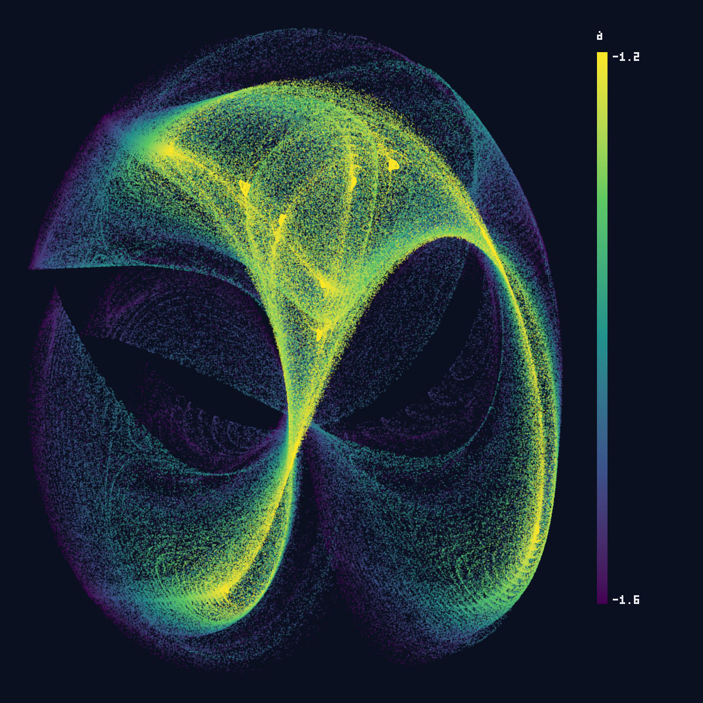
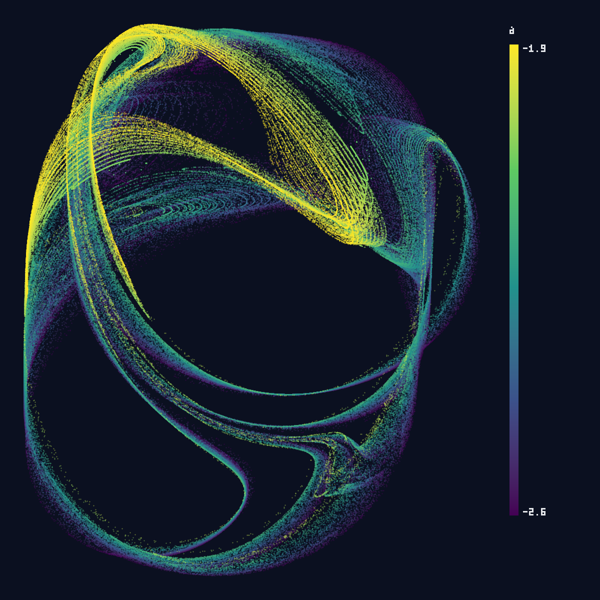
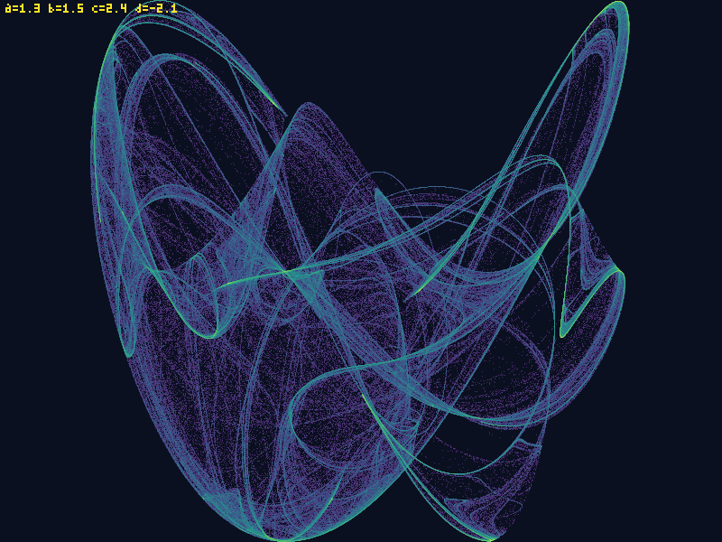

# StrangeArt

Generate 2D art from strange attractors with Julia. Hénon, Clifford, and de
Jong are discrete maps; continuous systems use the modular
`OrdinaryDiffEqVerner` package and `SciMLBase` instead of the full
`OrdinaryDiffEq` bundle. Parameter-sweep animations are available as GIFs
without a high-level image-processing dependency; giflib is supplied by the
small `Giflib_jll` package.

## Set up

Requires Julia 1.10 or later. Instantiate the project dependencies from the
repository root:

```powershell
julia --project=. -e "using Pkg; Pkg.instantiate()"
```

## Generate an image

Hénon remains the default:

```powershell
julia --project=. bin\strange-art.jl henon.svg
```

Choose a system with `--system`:

```powershell
julia --project=. bin\strange-art.jl lorenz.svg --system lorenz --points 50000 --projection xz
julia --project=. bin\strange-art.jl clifford.svg --system clifford --points 50000
```

Use a `.png` output path for a density rendering. This accumulates a million
orbit samples by default and maps occupancy through a logarithmic color scale;
`--points` changes the sample count:

```powershell
julia --project=. bin\strange-art.jl lorenz.png --system lorenz --projection xz
```

The density calculation and color mapping are separate operations. In Julia,
`density_grid(points; width, height, bounds)` returns a `UInt32` occupancy
matrix, and `write_density_png(path, grid; scale=:log)` applies the palette.
Use `scale=:linear` for a linear count mapping.

To compare density renders for all built-in systems, run:

```powershell
julia --project=. scripts\check-density-rendering.jl
```

The script writes 1600×1600 PNGs to the ignored `generated-art/` directory.
Edit its settings to adjust the point count, resolution, or ODE projections.

Available systems are `clifford`, `dejong`, `henon`, `lorenz`, `rossler`, and
`thomas`. Clifford and de Jong use the 2D maps
`x' = sin(a*y) + c*cos(a*x), y' = sin(b*x) + d*cos(b*y)` and
`x' = sin(a*y) - cos(b*x), y' = sin(c*x) - cos(d*y)`, respectively. The three
ODE systems use the adaptive Verner `Vern7` method and default to the x-y
projection. Open the resulting SVG in a browser or vector graphics editor.
Discrete maps default to discarding the first 1,000 iterations and plotting
the next 100,000 points. `--points` sets this retained iteration count; for
ODE systems it sets the number of samples from the end of the transient to the
end of integration. ODE systems accept `--projection xy`, `xz`, or `yz`; the
three discrete maps only support `xy`.

## Example artwork

These parameter sweeps show how changing Clifford's and de Jong's `a`
parameter changes the attractor. Point color encodes the parameter value.





Use a `.gif` output path to create a parameter-sweep animation. The default
sweep controls include Clifford's `a` (-1.6 to -1.2), de Jong's `a` (-2.6 to
-1.9), Hénon's `a` (0.8 to 1.4), Lorenz's `rho` (20 to 28), Rössler's `c` (2
to 6), and Thomas's `b` (0.32 down to 0.18):

```powershell
julia --project=. bin\strange-art.jl lorenz-transition.gif --system lorenz --values "20,24,24.7,24.74,24.8,28" --points 10000
julia --project=. bin\strange-art.jl transitions.gif --system all --frames 24
```

By default, the selected system's control parameter is sampled evenly across
its default range. Use `--values` with a comma-separated list to choose the
exact values (and thus the number of frames), which lets you concentrate
samples wherever the behavior changes quickly. For example, the Lorenz
sequence above adds several values near `rho=24.74`. `--values` cannot be
combined with `--frames`, `--start`, or `--stop`, and applies to one system at
a time. Otherwise, `--frames` chooses the sample count and `--start`/`--stop`
override the range. `--delay` sets the frame delay in centiseconds, and
`--projection` selects the ODE projection. `--points` sets the number of orbit
samples in each frame.
With `--system all`, six files are written using the output path as a prefix
(for example, `transitions-lorenz.gif`); use the default `xy` projection so it
also works for the three 2D discrete maps. CLI-generated transition GIFs are
fixed at 480×360 pixels.

For a reusable batch of parameter-colored PNGs, edit the per-system value lists
and settings in `scripts/generate-all-attractors.jl`, then run:

```powershell
julia --project=. scripts\generate-all-attractors.jl
```

The script overlays each system's parameter sweeps in one raster image. Point
color indicates the parameter value using a perceptually uniform, viridis-like
palette sampled uniformly along its Oklab color path; a color bar identifies
the range. It writes 2400×2400 PNGs with 300 DPI resolution metadata to
`generated-art/`, which is ignored by Git.

To make a color-coded de Jong animation, run
`julia --project=. scripts\generate-dejong-b-sweep.jl`. Each 800×600 PNG
frame sweeps `a` from -2.6 to -1.9 (color-coded as in the examples) while
advancing `b` from -2.5 to 2.5 across 60 frames. PNG frames with 300-DPI
metadata and the resulting GIF are written under the ignored `generated-art/`.

To make the corresponding density animation, run
`julia --project=. scripts\generate-dejong-b-density-sweep.jl`. It holds
`a=1.3`, `c=2.4`, and `d=-2.1` fixed while sweeping `b` from 1.5 to 2.5
across 100 frames. Each frame uses logarithmic density coloring and labels all
four parameter values in the upper-left corner. The 800×600 PNG frames and GIF
are written under the ignored `generated-art/`.



For custom ODE systems with two or more state variables, provide an in-place
right-hand side and parameters:

```julia
using StrangeArt

custom_system!(du, u, p, t) = (du[1] = p * u[2]; du[2] = -p * u[1])
points = ode_points(custom_system!, (1.0, 0.0); p=1.0)
```

`ode_points` returns the selected state variables as a 2D projection. Use
`duration`, `dt`, and `discard` to control integration and transient removal.
You can pass a different `solver` algorithm if you add its package to the project.

## Project layout

- `src/StrangeArt.jl` assembles the module and exports its public API.
- `src/attractors/` contains the individual attractors, shared ODE integration,
  and system registry.
- `src/rendering/` contains SVG, PNG, and GIF output code.
- `src/animation/` contains parameter-sweep generation for transition GIFs.
- `bin/` contains the command-line interface, `scripts/` contains reusable
  batch generation, and `test/` contains tests.

To add a built-in system, put its generator in `src/attractors/` and register
it in `src/attractors/registry.jl`.

The Julia REPL exposes API descriptions through help mode, for example
`?ode_points`, `?write_svg`, or `?write_transition_gif`.

## Run tests

```powershell
julia --project=. -e "using Pkg; Pkg.test()"
```
